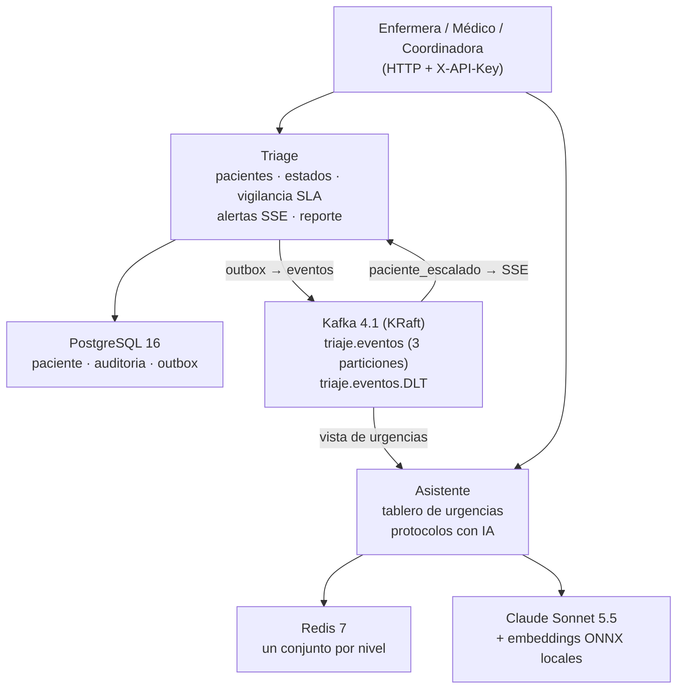

# VidaCruz — Triaje digital de urgencias con asistente clínico

Dos microservicios Java reactivos para la sala de urgencias de VidaCruz:

- **Triage** registra y clasifica pacientes (5 niveles), controla su estado con auditoría inmutable, escala a quien se le vence el plazo de atención (SLA), avisa en vivo al médico (SSE) y entrega un reporte de operación por hora.
- **Asistente** mantiene el tablero de urgencias a partir de los eventos del Triage y responde preguntas sobre protocolos clínicos con IA (RAG), citando la fuente y sin inventar.

Se comunican **solo por Kafka**.

El Triage **nunca llama al Asistente** (ni por HTTP ni de ninguna otra forma) y no depende de que esté disponible: si el Asistente, Redis o la IA fallan, el registro de pacientes sigue funcionando. El circuit breaker protege la llamada del Asistente al proveedor de IA y vive en el Asistente.

**URL en Azure:** Triage <http://4.236.197.111> · Asistente <http://172.171.189.251> (las rutas piden `X-API-Key`; ver [APIs](#apis) y [Despliegue en Azure](#despliegue-en-azure)).

---

## Arquitectura



**Estructura interna de cada servicio:** arquitectura hexagonal con CQRS, en tres módulos de Gradle:

- `dominio` — entidades, reglas y puertos (interfaces). Java + Reactor, sin Spring.
- `aplicacion` — comandos, consultas, manejadores y fábricas. Sin Spring.
- `infraestructura` — controladores, consumidores de Kafka, tareas programadas, adaptadores (R2DBC, Kafka, Redis, Spring AI) y configuración.

Las dependencias apuntan siempre hacia el dominio. Los comandos escriben por **repositorios** y las consultas leen por **DAO**. `ArquitecturaTest` (ArchUnit) hace fallar el build si se rompe esa regla.

---

## Cómo correrlo (un solo comando)

Requisitos: Docker. En la raíz del repositorio:

```bash
cp variables.ejemplo .env          # valores de prueba
docker compose up -d --build
```

Levanta Triage (`http://localhost:8081`), Asistente (`http://localhost:8082`), PostgreSQL, **un solo** Kafka y Redis.
Para la IA real, define `ANTHROPIC_API_KEY` en el entorno; sin ella el Asistente arranca igual y solo la consulta con IA responde 503.

**Prueba de punta a punta** (PowerShell): `./probar-punta-a-punta.ps1` revisa los puntos principales (registro, tablero por Kafka, traza, alta, transición prohibida, reporte, IA). Con `-ProbarAlerta` agrega la alerta SSE (levantar con `VIDACRUZ_SLA_MINUTOS_CRITICO=1` y `VIDACRUZ_VIGILANCIA_INTERVALO=PT10S`).

### Probar las APIs (Postman o cURL)

**Opción 1 · Postman (la más simple).** Botón **Import** y elige [`docs/postman/VidaCruz.postman_collection.json`](docs/postman/VidaCruz.postman_collection.json). Trae 12 peticiones en orden, y la primera de registro guarda sola el `id` del paciente para las siguientes. Solo completa las claves: abre la colección, pestaña **Variables**, y escribe `triage_key` y `asistente_key` (las claves de prueba están en el mensaje de entrega).

**Opción 2 · cURL.** Cada comando es **una sola línea** y también se puede pegar en Postman (**Import** → **Raw text**). Cambia `<CLAVE_TRIAGE>` y `<CLAVE_ASISTENTE>` por las claves de la entrega.

| | Triage | Asistente |
|---|---|---|
| **Azure** | `http://4.236.197.111` | `http://172.171.189.251` |
| **Local** (`docker compose`) | `http://localhost:8081` con la clave `clave-local-triage` | `http://localhost:8082` con la clave `clave-local-asistente` |

```bash
# 1. Salud (sin clave): debe responder {"status":"UP"}
curl http://4.236.197.111/actuator/health/readiness

# 2. Registrar un paciente URGENTE: responde 201 con "id" y "nivel"
curl -X POST http://4.236.197.111/triage/pacientes -H "X-API-Key: <CLAVE_TRIAGE>" -H "Content-Type: application/json" -d '{"nombreCompleto":"Maria Lopez","edad":34,"frecuenciaCardiaca":88,"presionSistolica":118,"presionDiastolica":76,"spo2":97,"temperatura":38.7,"dolor":4,"gcs":15,"quejaPrincipal":"Fiebre y dolor de garganta"}'

# 3. Consultar al paciente (usa el "id" del paso 2)
curl http://4.236.197.111/triage/pacientes/<ID> -H "X-API-Key: <CLAVE_TRIAGE>"

# 4. Pasarlo a consulta, y luego a alta
curl -X PATCH http://4.236.197.111/triage/pacientes/<ID>/estado -H "X-API-Key: <CLAVE_TRIAGE>" -H "Content-Type: application/json" -d '{"estado":"EN_CONSULTA"}'
curl -X PATCH http://4.236.197.111/triage/pacientes/<ID>/estado -H "X-API-Key: <CLAVE_TRIAGE>" -H "Content-Type: application/json" -d '{"estado":"ALTA"}'

# 5. Reporte de operación por hora
curl "http://4.236.197.111/triage/reportes/operacion?desde=2026-11-01T00:00:00Z&hasta=2026-12-01T00:00:00Z" -H "X-API-Key: <CLAVE_TRIAGE>"

# 6. Tablero de urgencias del Asistente: pacientes activos por nivel
curl http://172.171.189.251/asistente/estado-urgencias -H "X-API-Key: <CLAVE_ASISTENTE>"

# 7. Pregunta a la IA: respuesta con las fuentes (protocolo y sección)
curl -X POST http://172.171.189.251/asistente/consulta -H "X-API-Key: <CLAVE_ASISTENTE>" -H "Content-Type: application/json" -d '{"pregunta":"Como se maneja una crisis hipertensiva?"}'
```

**Alerta en vivo (RF-06)**, en dos pasos:

```bash
# A. Deja esta conexión abierta (es SSE: el servidor te empuja cada alerta)
curl -N http://4.236.197.111/triage/alertas/flujo -H "X-API-Key: <CLAVE_TRIAGE>" -H "Accept: text/event-stream"

# B. En otra ventana, registra un paciente CRÍTICO y no lo pases a consulta
curl -X POST http://4.236.197.111/triage/pacientes -H "X-API-Key: <CLAVE_TRIAGE>" -H "Content-Type: application/json" -d '{"nombreCompleto":"Luis Perez","edad":60,"frecuenciaCardiaca":90,"presionSistolica":120,"presionDiastolica":80,"spo2":97,"temperatura":36.8,"dolor":2,"gcs":7,"quejaPrincipal":"Perdida de conciencia"}'
```

El plazo del paciente crítico es de 5 minutos: pasado ese tiempo (y hasta 30 segundos más, lo que tarda el vigilante en revisar) llega `event: alerta` con el nombre, el nivel y los minutos de espera. En Windows usa Postman, o `curl.exe` desde PowerShell con archivos de datos.

---

## APIs

| Servicio | Método y ruta | Qué hace |
|---|---|---|
| Triage | `POST /triage/pacientes` | Registra y clasifica (201) |
| Triage | `GET /triage/pacientes/{id}` | Ficha con tiempo en el estado actual |
| Triage | `PATCH /triage/pacientes/{id}/estado` | `EN_CONSULTA` o `ALTA`; transición prohibida → 409 |
| Triage | `GET /triage/alertas/flujo` | Alertas de escalamiento por SSE |
| Triage | `GET /triage/reportes/operacion?desde=&hasta=` | Reporte por hora (máximo 31 días) |
| Asistente | `GET /asistente/estado-urgencias` | Pacientes activos por nivel |
| Asistente | `POST /asistente/consulta` | Respuesta de protocolos con fuentes |
| Ambos | `GET /actuator/health/liveness` y `/readiness` | Sondas (sin clave) |
| Ambos | `GET /actuator/prometheus` | Métricas (con clave) |

Todas las rutas de negocio piden `X-API-Key`. Los errores siguen Problem Details (RFC 9457) con `codigo` y `traceId`. OpenAPI: `triage/docs/api/openapi.yaml` y `docs/api/openapi-asistente.yaml`.

---

## Contrato de eventos

Topic `triaje.eventos` (3 particiones). **Llave = id del paciente**, así sus eventos llegan en orden. Valor: JSON con sobre.

```json
{
  "idEvento": "uuid",
  "tipo": "paciente_registrado | paciente_en_consulta | paciente_alta | paciente_escalado",
  "version": 1,
  "ocurridoEn": "2026-11-07T12:32:02.834650Z",
  "datos": { "idPaciente": "uuid", "nivel": "URGENTE", "estadoAnterior": null, "estadoNuevo": "REGISTRADO", "escalado": false }
}
```

- Cabecera `traceparent` (W3C): la traza de la petición original continúa en el Asistente.
- Entrega **al menos una vez**: los consumidores son idempotentes.
- Mensaje inválido → `triaje.eventos.DLT` sin reintentos; fallo temporal → 3 reintentos (1, 2 y 4 s) y luego DLT.

---

## Dónde está cada requisito

| Requisito | Dónde está en el código |
|---|---|
| Circuit breaker y modo degradado (503) sobre la llamada a la IA | `asistente/infraestructura/src/main/java/co/vidacruz/asistente/protocolo/adaptador/ia/AdaptadorAsistenteClaude.java` (configuración en `asistente/infraestructura/src/main/java/co/vidacruz/asistente/protocolo/configuracion/ConfiguracionAsistenteProtocolos.java`; el 503 sale de `asistente/infraestructura/src/main/java/co/vidacruz/asistente/configuracion/ManejadorGlobalErrores.java`) |
| Outbox transaccional y publicación a Kafka | `triage/infraestructura/src/main/java/co/vidacruz/triage/evento/adaptador/repositorio/AdaptadorR2dbcOutbox.java` y `triage/infraestructura/src/main/java/co/vidacruz/triage/evento/tarea/TareaPublicadorOutbox.java` |
| Escalamiento por SLA vencido (una sola vez, con varias réplicas) | `triage/infraestructura/src/main/java/co/vidacruz/triage/vigilancia/tarea/TareaVigilanciaSla.java` |
| Alertas en vivo (SSE) | `triage/infraestructura/src/main/java/co/vidacruz/triage/alerta/adaptador/sse/AdaptadorSseAlerta.java` |
| Reporte por hora (ventanas y percentiles en SQL) | `triage/infraestructura/src/main/java/co/vidacruz/triage/reporte/adaptador/dao/DaoReporteOperacionPostgres.java` |
| Tablero de urgencias idempotente (Redis) | `asistente/infraestructura/src/main/java/co/vidacruz/asistente/urgencias/adaptador/repositorio/RepositorioUrgenciasRedis.java` |
| Trazabilidad: el `traceId` cruza HTTP, Kafka y el Asistente | `triage/infraestructura/src/main/java/co/vidacruz/triage/error/FiltroTraceId.java` y `triage/infraestructura/src/main/java/co/vidacruz/triage/traza/LectorTraceparent.java` |
| Seguridad por API key | `triage/infraestructura/src/main/java/co/vidacruz/triage/seguridad/ConfiguracionSeguridad.java` y `asistente/infraestructura/src/main/java/co/vidacruz/asistente/configuracion/ConfiguracionSeguridad.java` |
| Sin bloqueos en el hilo reactivo (BlockHound) | `asistente/infraestructura/src/test/java/co/vidacruz/asistente/protocolo/ConsultaRagBlockHoundIntegracionTest.java` |
| Límites entre capas (ArchUnit) | `triage/infraestructura/src/test/java/co/vidacruz/triage/ArquitecturaTest.java` y `asistente/infraestructura/src/test/java/co/vidacruz/asistente/ArquitecturaTest.java` |
| Probes de salud (liveness y readiness) | Están en los manifiestos `deploy/k8s/20-triage.yaml` y `deploy/k8s/21-asistente.yaml`, apuntando a `/actuator/health/liveness` y `/actuator/health/readiness` |

## Tecnologías

Java 21 · Spring Boot 3.5 · Spring WebFlux (Reactor) · R2DBC + PostgreSQL 16 + Flyway · Spring for Apache Kafka · Redis 7 reactivo · Spring AI 1.1 (Anthropic + Transformers ONNX) · Resilience4j · Micrometer (Prometheus, tracing OpenTelemetry, logs ECS) · Testcontainers · ArchUnit · BlockHound · JaCoCo · Docker · Kubernetes (AKS).

---

## Decisiones clave

| # | Decisión | Por qué |
|---|---|---|
| 1 | 2 servicios unidos solo por Kafka | Aísla el riesgo: si la IA o Redis fallan, el registro de pacientes sigue |
| 2 | Hexagonal + CQRS, nombres en español | Muchas integraciones que cambian quedan detrás de puertos; lecturas y escrituras muy distintas |
| 3 | Evento JSON con sobre y versión; llave = paciente | Orden por paciente y evolución del contrato |
| 4 | Outbox transaccional | Paciente, auditoría y evento en una transacción: base y Kafka nunca en desacuerdo |
| 5 | Vigilancia SLA con job + `UPDATE ... RETURNING` | Con varias réplicas, la base deja escalar una sola vez |
| 6 | Spring AI 1.1 + Claude + embeddings ONNX locales | Anthropic no tiene embeddings; el modelo local es multilingüe y gratuito |
| 7 | Vectores en memoria, un fragmento por sección | 7 secciones: una base vectorial sería exceso; el puerto permite cambiarla |
| 8 | 5 barreras contra la alucinación | Entrada válida, sin protocolo no se llama a la IA, JSON obligatorio, fuentes y cifras validadas |
| 9 | Tablero con un conjunto Redis por nivel | Un evento repetido no cuenta doble (idempotente) |
| 10 | Alertas por SSE | Un solo sentido, HTTP normal, se prueba con curl |
| 11 | API key por cabecera, una por servicio | No hay usuarios ni roles en el alcance |
| 12 | AKS nivel gratis, 1 nodo | Kubernetes real con manifiestos al menor costo |
| 13 | Logs JSON (ECS) + tracing + métricas | Seguir una petición de punta a punta por su `traceId` |
| 14 | Spring Kafka (`KafkaTemplate` + listener con `Mono`) | Reactor Kafka se descontinuó en 2025 |
| 15 | 3 reintentos y luego DLT | Un mensaje malo no frena a los demás y no se pierde |
| 16 | Dos repos de trabajo unidos con `git subtree` | Se conserva el historial de cada servicio |

Detalle en [`docs/adr/`](docs/adr/): ADR-01 servicios · ADR-02 eventos y vista · ADR-03 outbox y escalamiento · ADR-04 RAG y modo degradado · ADR-05 alertas · ADR-06 Azure · ADR-07 Kafka reactivo y errores · ADR-08 repositorio.

---

## Supuestos (lo que el enunciado no decía)

1. Queja administrativa: igualdad exacta tras quitar tildes, mayúsculas y espacios sobrantes.
2. Signos vitales enteros; temperatura con 1 decimal. Un decimal en un campo entero → 400.
3. Pedir el mismo estado (`REGISTRADO → REGISTRADO`) → 409.
4. Reporte por hora de registro en `America/Bogota`; rango `[desde, hasta)`; espera y p95 solo de quien entró a consulta; horas sin registros no salen.
5. `tiempoEnEstadoActualMinutos` en minutos enteros.
6. La marca `escalado` se conserva aunque el paciente pase a consulta o alta.
7. Escalado es una marca, no un estado: el paciente sigue `REGISTRADO`.
8. "Relevante" = similitud ≥ 0,55, calibrado con el modelo ONNX real (con protocolo ≥ 0,70; sin protocolo ≤ 0,35).
9. Queja principal de máximo 500 caracteres.
10. El Asistente ignora tipos o versiones desconocidos; lo mal formado va a la DLT.
11. La readiness del Asistente no depende de Redis: sin Redis, el tablero responde 503 y el resto sigue.
12. Campos JSON en camelCase en español; registrar responde 201.
13. Un solo publicador del outbox entre réplicas (candado consultivo de PostgreSQL).
14. El SLA se guarda por paciente al registrarlo; cambiarlo afecta solo a los nuevos.
15. La pregunta a la IA tiene de 3 a 500 caracteres.
16. Sin protocolo, o con una barrera fallida: 200 con "No existe un protocolo disponible para esta pregunta" y `fuentes: []`.
17. Las cifras de la respuesta se validan contra los fragmentos, no contra la pregunta.
18. Sin `ANTHROPIC_API_KEY` el Asistente arranca; solo la consulta con IA responde 503.
19. El 503 del modo degradado es Problem Details con `codigo: IA_NO_DISPONIBLE`.

---

## Pruebas

```bash
cd triage && ./gradlew check       # 111 pruebas
cd asistente && ./gradlew check    # 58 pruebas
```

Unitarias, de integración con **Testcontainers** (PostgreSQL, Kafka y Redis reales), ArchUnit, BlockHound (sin bloqueos en el hilo reactivo) y cobertura mínima de 80 % con JaCoCo. Cubren, entre otras: la clasificación y sus rangos, la matriz de estados, dos cambios concurrentes, dos ciclos de vigilancia concurrentes (un solo escalamiento), orden por partición, idempotencia del tablero, DLT, alertas a varios suscriptores, el SQL del reporte y las barreras de la IA.

---

## Despliegue en Azure

AKS nivel gratis, 1 nodo `Standard_D2s_v4`, namespace `vidacruz`. Manifiestos en [`deploy/k8s/`](deploy/k8s/) y scripts en [`deploy/azure/`](deploy/azure/):

```powershell
docker login ghcr.io -u <usuario>                              # token de GitHub con write:packages
.\deploy\azure\construir-imagenes.ps1 -UsuarioGitHub <usuario>  # imágenes en GHCR
$env:VIDACRUZ_DB_PASSWORD = "..."; $env:VIDACRUZ_TRIAGE_API_KEY = "..."; $env:VIDACRUZ_ASISTENTE_API_KEY = "..."
.\deploy\azure\desplegar.ps1 -UsuarioGitHub <usuario>           # clúster + despliegue + URL
```

- Triage con 2 réplicas y Asistente con 1, con sondas de liveness, readiness y arranque.
- PostgreSQL y Kafka como StatefulSet con disco; Redis como Deployment.
- Triage y Asistente expuestos con `Service` tipo `LoadBalancer` (IP pública).
- Claves en un `Secret` creado desde variables de entorno; nunca en git.
- En producción: Azure Database for PostgreSQL, Event Hubs (Kafka) y Azure Cache for Redis, sin cambiar el código.

---

## Workspace de desarrollo con IA (`WORKSPACE_IA`)

> Workspace diseñado e implementado por **Johan Fernando Sanchez Cano**, ingeniero de software de IA.

**Qué es.** Un entorno de trabajo propio, en un repositorio aparte, donde dos asistentes de IA con roles distintos construyen software bajo la dirección del autor. Se pasan el trabajo **solo por archivos**, nunca por memoria de conversación; por eso todo queda como evidencia.

| Herramienta | Rol | Qué produce |
|---|---|---|
| Claude Code | Pensar: arquitectura, especificaciones (RFC), documentación y revisión contra el RFC | contexto del proyecto, `rfc-activo.md`, documentación, informes de QA contra el RFC |
| Codex | Construir: plan, código, pruebas, revisión de código y QA de APIs | el código, `specs-personal/`, informes y observaciones |

**Cómo está construido**

- **Una carpeta por proyecto** con siempre la misma forma: ficha y reglas, `ESTADO.md` (bitácora de dónde va), `contexto/` (negocio, arquitectura y decisiones), `desarrollo-ia/<servicio>/` (RFC, informes y observaciones), `codigo/<servicio>/` (un repositorio git por servicio) y `docs/`.
- **12 skills de Claude Code y 56 de Codex** (por stack: Java, Python y Angular). Cubren crear el proyecto, decidir la arquitectura, escribir el RFC, planear, construir, probar, revisar código, hacer QA, corregir, refactorizar y documentar.
- **Subagentes especializados** (13 de Codex y 2 de Claude Code), cada uno con una sola mirada: arquitectura hexagonal, Java reactivo moderno, código limpio, QA destructivo contra la API real y trazabilidad contra el RFC. Solo reportan; no modifican código.
- **Un orquestador en Python** (`orquestador.py`, `desarrollo.py`, `fix.py`, `refactor.py`) que corre una entrega completa: llama a Claude y a Codex, guarda el estado en JSON, consulta a un agente "copiloto" y solo escala al autor lo que únicamente él puede decidir. Dos corridas pueden ir en paralelo (carriles).
- **Una plantilla de proyecto y scripts de PowerShell** que crean cada proyecto con su estructura y su ficha.

**El ciclo de una entrega**

```
idea → proyecto → arquitectura → RFC → plan → verificación del plan contra el RFC
     → construcción → pruebas → revisión de código y QA → informe → siguiente RFC
```

Tras cada entrega hay dos ciclos más: **corrección** (fixes puntuales) y **refactor** (cambia la estructura sin cambiar el comportamiento).

**Reglas que no se rompen**

1. **El RFC es la ley.** Nada se construye ni se aprueba si no está en el RFC, y solo el autor puede cambiarlo.
2. **No inventar.** Sin fuente no existe: lo de negocio se pregunta; lo técnico se decide dentro de la arquitectura documentada.
3. **Secretos:** las claves nunca se leen, imprimen ni guardan; solo se usan nombres de variables de entorno.
4. **Sin commit ni push** sin que el autor lo pida.
5. **Cierre de toda tarea:** un informe con estado y lo que faltó, la bitácora en `ESTADO.md` y los documentos vivos al día.

**Cómo se usó en esta prueba.** El trabajo se partió en entregas (RFC) por servicio y cada una pasó por el ciclo anterior. Las especificaciones y los informes quedan en `*/specs-personal/` y `*/informes/` como evidencia del proceso. El flujo está dirigido y verificado por el autor: las pruebas en vivo encontraron fallas que las automáticas no veían (configuración de Kafka de un solo broker, parámetros del modelo, formato de la respuesta de la IA, propagación de la traza), todas corregidas con su prueba.

---

## Limitaciones conocidas

- La tabla `outbox` no se limpia: falta un job que borre los eventos enviados antiguos.
- Infraestructura de un solo nodo y un solo broker de Kafka: sin alta disponibilidad.
- La barrera de cifras no detecta afirmaciones inventadas sin números; el siguiente paso es evaluar la fidelidad con un segundo modelo.
- Sin límite de peticiones en el código: iría en el API Gateway o el ingress.

---

## Estructura

```
triage/          servicio Triage (Gradle multimódulo: dominio, aplicacion, infraestructura)
asistente/       servicio Asistente (misma estructura)
deploy/k8s/      manifiestos de Kubernetes
deploy/azure/    scripts de imágenes, despliegue y apagado
docs/adr/        decisiones de arquitectura
docs/postman/    colección de Postman con las 12 peticiones
docs/api/        OpenAPI del Asistente
docker-compose.yml, variables.ejemplo, probar-punta-a-punta.ps1
```
